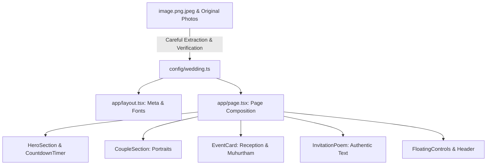

# Project Architecture & Technical Foundation

- **Project:** Vignesh & Sowmi (Gowri) Wedding Website
- **Status:** Phase 0 Baseline Established
- **Framework:** Next.js (App Router) + React 18 + TypeScript + Tailwind CSS

---

## 1. Architectural Principles & Technical Rationale

### 1.1 Why Next.js App Router with TypeScript
- **Modern & Maintainable**: The Next.js App Router provides a clean directory-based routing paradigm, server-first baseline, and seamless metadata integration for rich social sharing (`og:image`, `twitter:card`).
- **Strict Type Checking**: All wedding event dates, time zones, venues, couple profiles, and poetry are strictly typed in `config/wedding.ts`, eliminating runtime undefined errors and preventing content drift across pages.
- **Zero Heavy Backend Overhead**: The website does not require a database, authentication server, or external API to render. Everything is statically determinable, ultra-fast, and hostable on Vercel, GitHub Pages, or Netlify with near-zero latency.

### 1.2 Performance-First & Privacy Standards
- **Authentic Assets Only**: No AI generation, no face modifications, no stock photography. Authentic photographs supplied by the couple are safely preserved in `source-assets/` and `public/images/original/`.
- **Responsive Derivative Images**: Web-optimized copies are served from `public/images/optimized/` with explicit layout dimensions and modern responsive attributes.
- **Privacy Enforcement**: Private phone numbers, personal email addresses, and unverified map coordinates are omitted from public commits and disabled in config until explicit consent is granted.
- **No Autoplay Audio**: Any background music or audio will be triggered strictly by explicit user gesture (e.g. "Enter Wedding Celebration" button or floating sound toggle), fully adhering to modern browser autoplay policies.

---

## 2. Directory Structure & File Map

```
Vignesh-Sowmya_Wedding_Website/
├── app/
│   ├── favicon.ico
│   ├── globals.css              # Global styling tokens, font variables, and utility classes
│   ├── layout.tsx               # Root layout with font imports, meta tags, and accessibility hooks
│   └── page.tsx                 # Phase 0 application shell & design baseline preview
├── components/
│   ├── layout/
│   │   ├── Header.tsx           # Sticky top navigation with sound & language triggers
│   │   └── Footer.tsx           # Cultural closing, blessings, and credits
│   ├── navigation/
│   │   └── FloatingControls.tsx # Sound and language toggles
│   ├── wedding/
│   │   ├── HeroSection.tsx      # Couple names, date, traditional quote, and live countdown
│   │   ├── CoupleSection.tsx    # Vignesh & Sowmi individual portraits with sacred borders
│   │   ├── EventCard.tsx        # Reception & Muhurtham cards with calendar hooks
│   │   ├── InvitationPoem.tsx   # Verified invitation card poetry presentation
│   │   └── CountdownTimer.tsx   # Client-side live countdown to 10th & 11th Nov 2026
│   └── ui/
│       ├── Button.tsx           # Accessible button primitive (Primary, Glow, Gold, Outline)
│       ├── GlassCard.tsx        # Frosted glass container with golden border
│       └── Badge.tsx            # Verification and status badges
├── config/
│   └── wedding.ts               # Single source of truth for couple, events, poetry, and meta
├── docs/
│   ├── 01_REFERENCE_AUDIT.md    # 17-point audit of https://wedding.santhoshnc.me/
│   ├── 02_PROJECT_ARCHITECTURE.md # This architecture specification
│   ├── 03_DESIGN_SYSTEM.md      # Color tokens, typography, spacing, breakpoints, accessibility
│   ├── 04_CONTENT_AND_ASSET_MANIFEST.md # Manifest of source assets and extracted invitation data
│   ├── 05_IMPLEMENTATION_ROADMAP.md # Phase 1 to Phase 3 development roadmap
│   └── 06_VALIDATION_REPORT.md  # Comprehensive test, lint, build, and rendering results
├── public/
│   ├── fonts/                   # Local font fallbacks
│   └── images/
│       ├── original/            # Bit-for-bit preserved source files
│       │   ├── image.png.jpeg
│       │   ├── IMG-20250210-WA0016.jpg.jpeg
│       │   ├── IMG-20260612-WA0001.jpg.jpeg
│       │   └── IMG-20261019-WA0000.jpg.jpeg
│       └── optimized/           # Clean web-delivery derivatives
│           ├── bride-portrait.jpg
│           ├── groom-portrait.jpg
│           ├── couple-traditional.jpg
│           └── invitation-card.jpg
├── source-assets/               # Immutable local backup of original WhatsApp files
├── next.config.mjs
├── package.json
├── postcss.config.js
├── tailwind.config.ts
└── tsconfig.json
```

---

## 3. Data Flow & Content Architecture



---

## 4. Environment and Build Workflow
- **Node.js Target**: v20+ / v24+
- **Commands**:
  - `npm run dev`: Starts local development server on `localhost:3000`.
  - `npm run typecheck`: Runs TypeScript compiler without emit to guarantee type safety.
  - `npm run build`: Builds optimized production static bundle.
  - `npm run start`: Runs production server locally.
