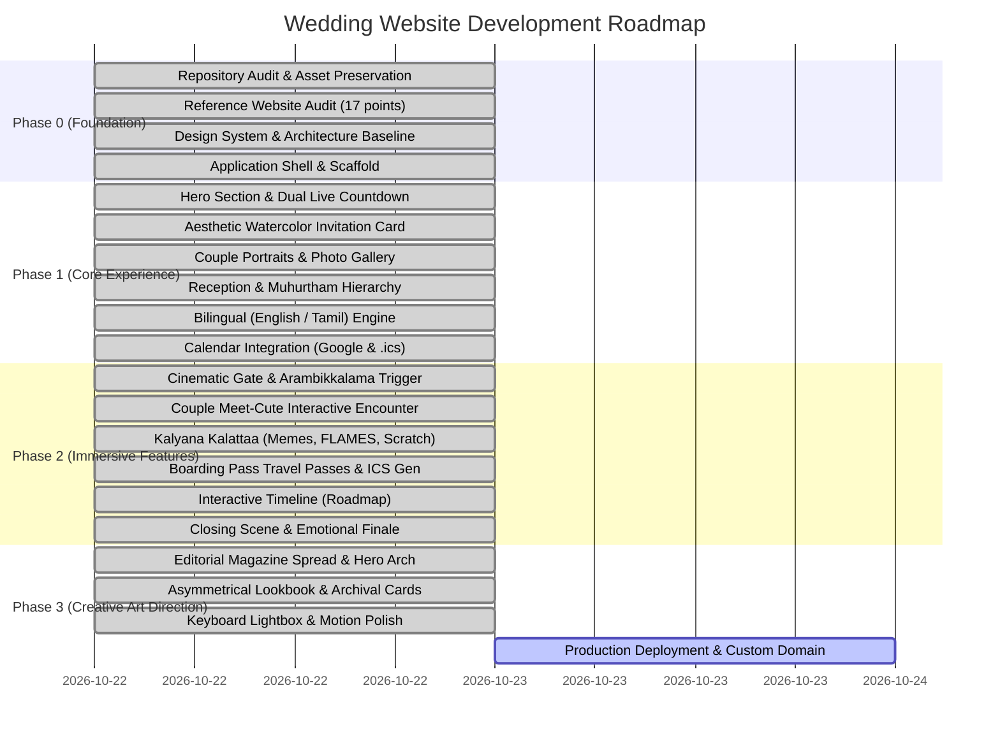

# Phase 1 to Phase 3 Implementation Roadmap

- **Project:** Vignesh & Sowmi (Gowri) Wedding Website
- **Current Milestone:** Phase 3 (Creative Art Direction, Visual Polish & Interaction Refinement Completed)

---

## Roadmap Overview

---

## Detailed Milestone Status

### Phase 0: Foundation & Asset Preservation (COMPLETED)
- [x] Workspace inspection and bit-for-bit source asset preservation in `source-assets/` and `public/images/original/`.
- [x] 17-point audit of reference site (`https://wedding.santhoshnc.me/`).
- [x] Next.js App Router, TypeScript 5, and Tailwind CSS configuration.
- [x] Centralized typed configuration (`config/wedding.ts`).

---

### Phase 1: Core Storytelling & Aesthetic Card (COMPLETED)
- [x] Custom watercolor digital invitation card matching user reference (Saptapadi sacred footsteps, golden zari dhoti & saree, marigold garlands, banana leaves).
- [x] Verified venue details:
  - **Reception:** Namperumal Thirumana Mandapam, Vaiyappamalai (10 Nov 2026, 6:00 PM IST)
  - **Marriage:** Sri Arulmigu Kailasanathar Thirukovil, Elur (11 Nov 2026, 4:30 AM – 6:00 AM IST)
- [x] Dual live countdown timer with milestone awareness.
- [x] Bilingual English & Tamil toggle.

---

### Phase 2 & 3: Art Direction, Playful Immersion & Polish (COMPLETED)
- [x] **Cinematic Entrance Gate**: Sacred Tamil welcome (*"கல்யாணம் பண்ணப் போறோம்… அதுவும் மாஸா பண்ணப் போறோம்!"*), dual flower petal confetti burst, and *"ஆரம்பிக்கலாமா? (Arambikkalama?)"* trigger.
- [x] **Editorial Bridal Magazine Hero**: Split-screen narrative spread, oversized dates (`10 & 11`), gold text gradients, and traditional temple arch (*Thiruvachi*) photo frame.
- [x] **Asymmetrical Lookbook Couple Section**: Architectural layout with central talisman medallion.
- [x] **Couple Meet-Cute Scene**: Interactive slider/scroll encounter uniting bride & groom silhouettes and revealing the genuine couple photograph with invitation verse.
- [x] **Kalyana Kalattaa Hub**: Tamil wedding memes, cosmic FLAMES game, and gold foil scratch card blessing.
- [x] **Event Boarding Passes**: "LOVE AIRLINES" passes with stamp effect and dynamic `.ics` calendar generation.
- [x] **Photo Lookbook with Lightbox**: Keyboard navigation (Arrow keys + Esc).
- [x] **Web Audio Harmony Player**: Authentic pentatonic temple chimes via Web Audio API.
- [x] **Closing Scene**: Authentic couple photo, concluding invitation poem, and return to top.

---

### New Feature: "The Groom's Journey to His Bride" (COMPLETED)
- [x] **Character Likeness Artwork**:
  - Illustrated Groom character inspired by `IMG-20261019-WA0000.jpg.jpeg` (`/images/journey/groom-character.jpg`).
  - Illustrated Bride character inspired by `IMG-20250210-WA0016.jpg.jpeg` (`/images/journey/bride-character.jpg`).
- [x] **Bespoke South Indian Countryside Map**:
  - Handcrafted SVG vector map (`viewBox="0 0 1000 550"`), winding cobblestone road, coconut groves, banana trees, lotus pond with arched stone bridge, village huts with terracotta roofs, and distant temple gopuram silhouette.
- [x] **Interactive Story Checkpoints**:
  - Checkpoint 1 (05%): *"The Departure"* — *"Destination locked. Confidence: 100%. Navigation skills: under review."*
  - Checkpoint 2 (35%): *"The Village Detour"* — *"Even the scenic route knows where I'm going."*
  - Checkpoint 3 (70%): *"The Final Approach"* — *"Okay, heart. Please behave. We're nearly there."*
  - Checkpoint 4 (100%): *"Arrival at Mandapam"* — *"Found you. Nowhere else to be."*
- [x] **Multi-Mode Controls**:
  - "START MY ADVENTURE →" initial launch CTA.
  - "Advance →" discrete milestone stepper.
  - "Play / Pause" continuous animation loop.
  - Interactive scrub slider (5% to 100%).
  - "Skip to End" direct jump.
  - "Reset / Relive The Journey ↺".
- [x] **Grand Reunion Celebration**:
  - Dual confetti bursts (`canvas-confetti`).
  - Revealing authentic, unmodified couple wedding photograph (`couple-traditional.jpg`).
  - Headline: *"Every little turn brought this story closer to forever."*
  - Excerpt from the approved invitation poem and *"And so begins their forever."*

---

### Phase 4: Stabilization, Creative Redesign & Original Storytelling (COMPLETED)
- [x] **Technical & Visual Stability Audit**: Completed [`docs/07_STABILITY_AUDIT.md`](file:///c:/Users/deeks/Downloads/Vignesh-Sowmya_Wedding_Website/docs/07_STABILITY_AUDIT.md) logging and resolving 8 defects.
- [x] **Dynamic SVG Boundary Clamping**: Resolved speech bubble edge clipping by calculating `bubbleOffsetX` within `[20, 980]`.
- [x] **Countdown Safe Pre-clamping**: `safeDiff = Math.max(0, currentDiff)` eliminating negative unit calculation anomalies.
- [x] **Sealed Wedding Invitation Reveal**: Implemented gold wax-seal unboxing moment in `AestheticInvitationCard.tsx` with smooth unfolding and reseal action.
- [x] **Operation: Wedding Day Control Room**: Implemented `WeddingControlRoom.tsx` console with interactive Milestone 01 (Reception, 10 Nov) & Milestone 02 (Muhurtham, 11 Nov) tabs.
- [x] **Tamil Wedding Fun Corner**: Rebuilt `KalyanaKalattaa.tsx` with:
  - Fictional Wedding Weather Report (*100% chance of blessings, happy tears, and extra servings*).
  - Interactive Guest Mission Checklist (5 tasks with local state completion confetti).
  - The Feast Forecast (dessert decisions announcement with animated secret reveal).
  - The Family Photo Challenge (4 prompts for real offline celebrations).
  - Auspicious Gold Scratch Card.
- [x] **Boarding Passes Microcopy**: Updated passenger to "Our Honored Guest & Family" with *"Your blessings are the real VIP pass."*
- [x] **Centralized Creative Content**: Structured in [`config/storyContent.ts`](file:///c:/Users/deeks/Downloads/Vignesh-Sowmya_Wedding_Website/config/storyContent.ts).
- [x] **Automated Checks & Browser QA**: TypeScript and production build 100% clean; verified via automated browser testing.

